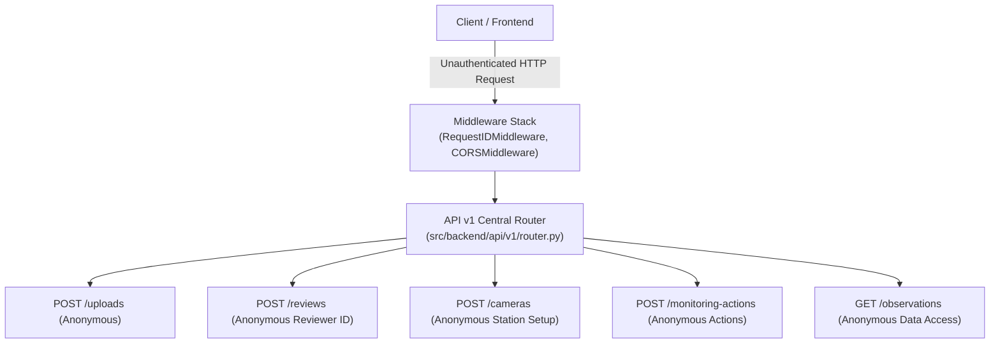
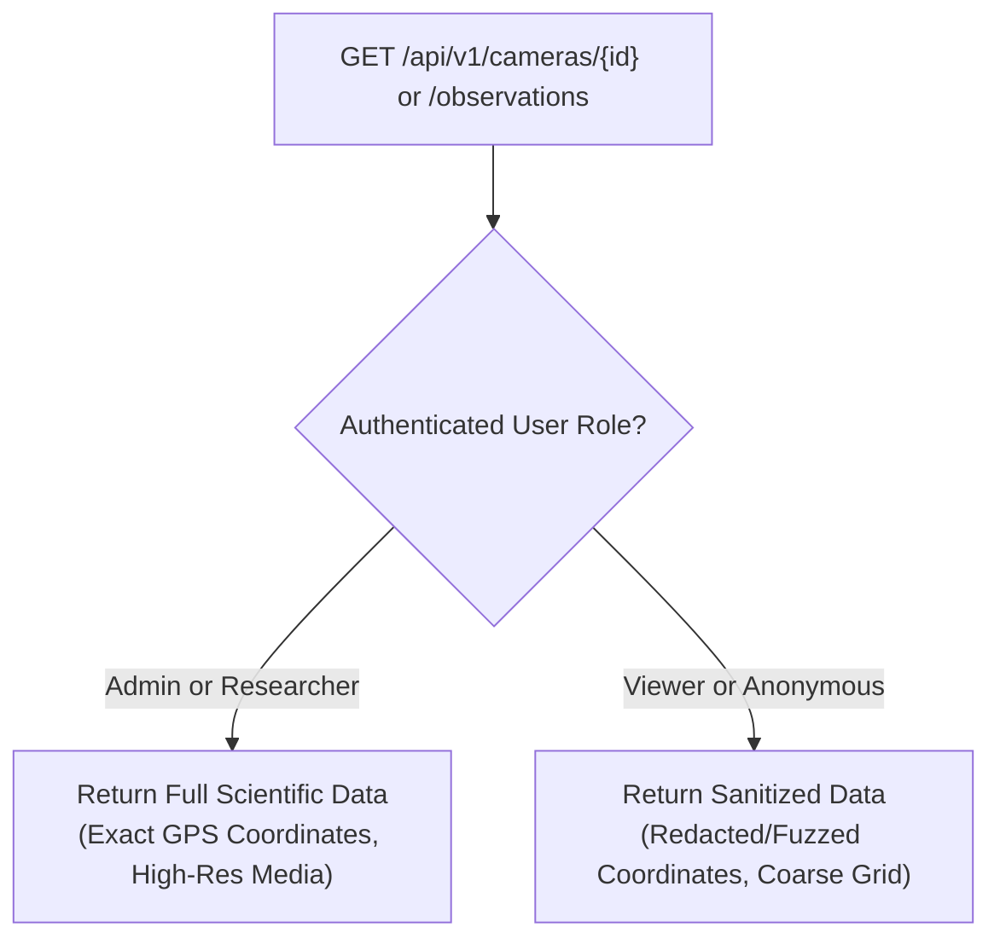
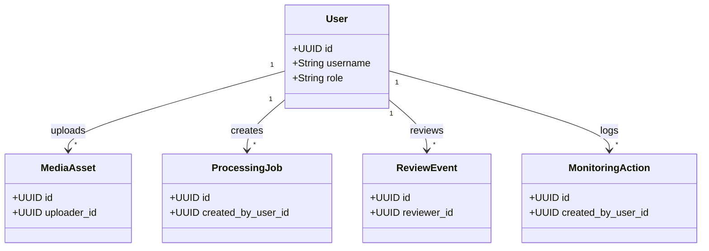
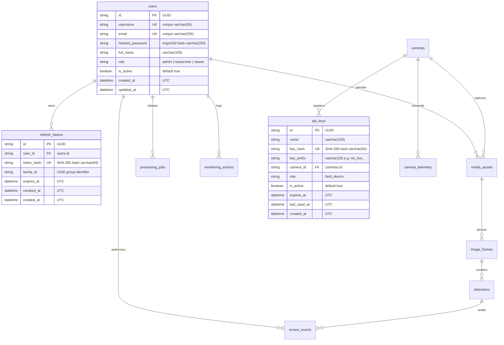

# WILDSCOPE AI — Security Architecture Audit: Authentication, Access Control & Wildlife Data Protection

**System:** WILDSCOPE AI Backend API (`src/backend`)  
**Accountable Backend Architect:** Santosh Yuvaraj  
**Repository:** `HFT26-TEAM-8`  
**Git Branch:** `santosh`  
**Audit Reference:** Finding C-01 from [`docs/backend/reliability-audit-report.md`](file:///c:/Users/santosh/OneDrive/Desktop/HFT26-TEAM-8/docs/backend/reliability-audit-report.md)  
**API Contract:** [`docs/api-contract.md`](file:///c:/Users/santosh/OneDrive/Desktop/HFT26-TEAM-8/docs/api-contract.md)  
**Audit Classification:** AUTHORITATIVE ARCHITECTURAL SPECIFICATION & SECURITY ROADMAP  
**Date:** October 31, 2026  
**Status:** **FINALIZED FOR SECURITY PHASE 1 IMPLEMENTATION**

---

## Executive Summary

During the initial Backend Reliability & Security Audit ([`docs/backend/reliability-audit-report.md`](file:///c:/Users/santosh/OneDrive/Desktop/HFT26-TEAM-8/docs/backend/reliability-audit-report.md)), critical finding **C-01** identified the complete absence of authentication, authorization, and identity verification across all `/api/v1` endpoints. While Remediation Cycles A and B successfully hardened functional reliability, chunked streaming storage, database indexing, and session safety, the platform currently permits unauthenticated clients to invoke sensitive mutations—including advancing monotonic dataset revisions, registering camera traps, submitting unverified human scientific reviews, and uploading arbitrary media files.

This refined and finalized security architecture provides a comprehensive, production-grade, and hackathon-aligned security foundation. It integrates:
1. **Stateless JWT-based Authentication** via FastAPI's native `OAuth2PasswordBearer` and HMAC-SHA256 (`HS256`) tokens.
2. **Role-Based Access Control (RBAC)** across three human roles (**Administrator**, **Researcher**, **Viewer**) and an automated service role (**FieldDevice**).
3. **Wildlife Location & Sensitive Taxa Protection** preventing illegal poaching and unauthorized geographic tracking via coordinate redaction/fuzzing.
4. **Ownership Scoping & IDOR Prevention** binding uploads, jobs, and audit logs to authentic user identities.
5. **Defensive Token Invalidation & Refresh Token Rotation (RTR)** with replay detection and token family invalidation.
6. **Zero-Default Administrator Provisioning** ensuring credentials are never committed to code or migrations.
7. **Strict Field-Device Isolation** scoping hardware keys strictly to specific camera stations.
8. **An Exhaustive Permission Matrix** covering all 18 existing API endpoints and 4 authentication lifecycle endpoints.

---

## 1. Current State Architectural Assessment

An exhaustive inspection of the existing codebase reveals the following baseline:



### Existing Protections vs. Critical Vulnerabilities

| Architectural Component | Existing Safeguards (Cycles A & B) | Identified Security Deficiencies |
|:---|:---|:---|
| **Identity & Authentication** | None. Review payload accepts arbitrary `reviewer_id: str`. | **CRITICAL:** Zero authentication mechanisms. No credential verification, token parsing, or session cookies exist. Any HTTP client can pose as an authenticated ecologist. |
| **Authorization & RBAC** | None. All endpoints execute under implicit superuser privileges. | **CRITICAL:** No role segmentation. A public observer has identical mutation capabilities to a sanctuary administrator. |
| **Routing & Dispatch** | Centralized router at `src/backend/api/v1/router.py`. | All 18 endpoints are registered without FastAPI `Security()` or `Depends()` authentication guards. |
| **Wildlife Data Protection** | None. Full precision GPS coordinates returned to any caller. | **CRITICAL:** Vulnerable to poaching reconnaissance. Exact camera coordinates are exposed without role checks. |
| **Middleware Stack** | `RequestIDMiddleware` (UUID tracking); `CORSMiddleware` (restricted origins). | Lacks security headers (`HSTS`, `X-Frame-Options`, `CSP`), rate-limiting middleware, and token extraction middleware. |
| **Configuration (`config.py`)** | `DEBUG`, `DATABASE_URL`, `STORAGE_ROOT`, `CORS_ORIGINS`. | Lacks authentication settings: no `JWT_SECRET_KEY`, `ALGORITHM`, `ACCESS_TOKEN_EXPIRE_MINUTES`, or password hashing parameters. |
| **Database Schema** | Domain entities (`MediaAsset`, `Detection`, `Camera`, `ReviewEvent`, `MonitoringAction`). | Lacks `User`, `RefreshToken`, and `ApiKey` tables. No foreign keys exist linking uploaded assets or reviews to an authentic user identity. |
| **Scientific Immutability** | Database events enforce append-only `ReviewEvent` records and immutable `Detection` outputs. | While records cannot be edited or deleted once written, illegitimate records can be injected anonymously, corrupting the scientific audit baseline. |

---

## 2. Wildlife Data Protection & Anti-Poaching Controls

Camera traps deployed in national parks capture endangered and critically endangered species (e.g. *Panthera tigris*, *Rhinoceros unicornis*). Unrestricted publication of exact GPS coordinates creates severe anti-poaching and biosecurity hazards.



### Architectural Rules for Wildlife Privacy
1. **Coordinate Redaction & Spatial Fuzzing:**
   - In the database, `Camera.latitude` and `Camera.longitude` remain exact double-precision floating-point numbers to preserve scientific rigor.
   - In API responses (`GET /api/v1/cameras`, `GET /api/v1/cameras/{id}`, `GET /api/v1/observations`):
     - **Administrator & Researcher:** Receives exact `coordinates: [lon, lat]`.
     - **Viewer:** Receives either `coordinates: null` or spatially fuzzed coordinates (rounded to $0.1^\circ$, representing a ~11 km coarse grid buffer), alongside a boolean flag `"coordinates_obfuscated": true`.
2. **High-Resolution Media Watermarking/Access:**
   - Original RAW/High-Res media downloads via `GET /api/v1/images/{image_id}/content` are restricted to Researchers and Administrators.
   - Viewers receive web-optimized, non-geotagged compressed previews.
3. **Preservation of Scientific Immutability:**
   - Access control is applied purely at the serialization/presentation layer. The underlying database storage is never altered or truncated, ensuring ecological analytics (e.g. Shravan's spatial occupancy models) retain 100% precision.

---

## 3. Resource Ownership & IDOR Countermeasures

Insecure Direct Object Reference (IDOR) vulnerabilities occur when an endpoint takes an ID and returns or mutates the object without validating that the requester owns or has permission to interact with it.

### Ownership Matrix & Invariants



1. **Uploads and Background Processing Jobs:**
   - `MediaAsset.uploader_id` is stamped from the authenticated token's `sub`.
   - `ProcessingJob.created_by_user_id` is stamped from the authenticated token's `sub`.
   - **Access Invariant:** A Researcher can only view and track processing jobs (`GET /api/v1/jobs/{job_id}`) that they initiated (`job.created_by_user_id == current_user.id`). Administrators possess global oversight and may inspect any job.
2. **Sanctuary-Wide Shared Research Assets:**
   - Once processed, `Detection`, `ImageFrame`, and `Encounter` records become shared sanctuary research assets accessible to all verified Researchers and Administrators.
   - Deletion of raw vision model outputs is prohibited by existing database immutability rules.
3. **Binding Reviewer Identity (F20 Invariant):**
   - The review creation endpoint (`POST /api/v1/reviews`) currently accepts `reviewer_id` in the request body.
   - **Hardening Invariant:** Client-supplied `reviewer_id` is completely ignored. The backend overrides `review_event.reviewer_id = current_user.id` directly from the validated cryptographic token claims. Anonymous or spoofed reviewer identities are rejected.

---

## 4. Token Invalidation, Refresh Security & Credential Handling

### 1. Dual-Token Architecture
```mermaid
sequenceDiagram
    autonumber
    actor User as Researcher / Admin
    participant FE as React Client
    participant API as FastAPI Backend (/api/v1)
    participant DB as SQLite / PostgreSQL

    User->>FE: Submit Credentials
    FE->>API: POST /api/v1/auth/login
    API->>DB: Verify User & Password Hash (Argon2id)
    API->>DB: Persist Hashed Refresh Token (Family F1)
    API-->>FE: HTTP 200 { access_token, user } + Set-Cookie: refresh_token (HttpOnly)
    
    Note over FE,API: Normal Authenticated Access
    FE->>API: POST /api/v1/reviews (Authorization: Bearer <access_token>)
    API-->>FE: HTTP 201 Created

    Note over FE,API: Token Expiration & Silent Rotation
    FE->>API: POST /api/v1/auth/refresh (Cookie: refresh_token)
    API->>DB: Lookup Hash & Verify Family F1 (Active)
    API->>DB: Mark Old Token Revoked; Issue New Token (Family F1)
    API-->>FE: HTTP 200 { new_access_token } + Set-Cookie: new_refresh_token
```

### 2. Immediate Token Invalidation Strategy
- **The Problem:** Purely stateless JWTs remain valid until their expiration timestamp (`exp`), even if a user is disabled or demoted.
- **The Solution (Two-Tier Invalidation):**
  1. **Short-Lived Access Tokens:** Standard TTL is restricted to **15 minutes**. Compromised tokens expire rapidly.
  2. **Active User Verification on Request:** The `get_current_active_user` dependency queries the user record (or cached status) and verifies `user.is_active == True`. If an account is disabled by an Administrator:
     - All subsequent API calls immediately return **HTTP 403 Forbidden** (`USER_ACCOUNT_DISABLED`).
     - All active refresh tokens for that user ID are instantly marked revoked in `refresh_tokens`.

### 3. Refresh Token Rotation (RTR) & Replay Attack Invalidation
- **Hashed Storage:** Refresh tokens are never stored in plain text. Only their deterministic SHA-256 hash (`token_hash`) is written to the database.
- **Token Family Identification:** Every refresh token belongs to a `family_id` (UUID).
- **Single-Use Rotation:**
  - Presenting a valid refresh token generates a new access token and a new refresh token within the same `family_id`. The old token is immediately marked `is_revoked = True`.
- **Replay Attack Detection:**
  - If an already-revoked refresh token is presented at `/auth/refresh`, the server detects token theft / replay.
  - **Action:** The server immediately triggers **Family Invalidation**, revoking all refresh tokens matching that `family_id` and requiring re-authentication.

### 4. Secure Cookie & CSRF Mitigation
- Refresh tokens are transmitted strictly via an `HttpOnly`, `Secure`, `SameSite=Strict` cookie scoped to `/api/v1/auth`.
- JavaScript cannot read the cookie, neutralizing token theft via Cross-Site Scripting (XSS).
- Cross-Site Request Forgery (CSRF) is mitigated by:
  1. `SameSite=Strict` browser enforcement.
  2. Custom request header requirement (`X-Requested-With: XMLHttpRequest` or Anti-CSRF token header) verified on state-changing `/auth` routes.
  3. Strict CORS origin whitelisting (`CORS_ORIGINS = ["http://localhost:3000", "http://localhost:5173"]`) with `allow_credentials=True`.

---

## 5. Administrator Provisioning Strategy

To eliminate hardcoded credentials and prevent accidental exposure in git histories, the initial administrator bootstrap will follow a strict zero-default procedure:

### 1. Production & Hackathon Provisioning Rule
- **NEVER** insert default passwords (e.g. `admin / admin123`) in Alembic migrations or source code.
- **Provisioning Methods:**
  1. **CLI Bootstrap Utility:** A command-line script callable by park operators:
     ```powershell
     python -m src.backend.cli create-admin --username admin --email admin@wildscope.org --password <StrongPassword123!>
     ```
  2. **Environment Variable One-Time Seed:**
     - If no user records exist in the database upon startup, and both `INITIAL_ADMIN_USERNAME` and `INITIAL_ADMIN_PASSWORD` are present in the environment:
       - Hash the password with Argon2id.
       - Insert the user with `role = "admin"`.
       - Log a prominent warning: `[WILDSCOPE Security] Initial administrator account provisioned. Please rotate credentials.`
       - Clear the environment variables from memory.

---

## 6. Field-Device Isolation & Camera Station Scoping

Autonomous camera traps and telemetry relay nodes communicate unattended across satellite, cellular, or LoRa networks.

```mermaid
flowchart LR
    Node["Camera Station CAM-042"] -->|POST /cameras/CAM-042/telemetry<br>X-API-Key: ws_live_xxx| Gateway["API Gateway"]
    Gateway --> Guard{"Key Valid & Bound to CAM-042?"}
    Guard -->|Yes| Ingest["Ingest Telemetry Log"]
    Guard -->|No (Wrong Camera)| Reject1["HTTP 403 Forbidden<br>(DEVICE_STATION_MISMATCH)"]
    Guard -->|Key attempts /reviews| Reject2["HTTP 403 Forbidden<br>(DEVICE_SCOPE_RESTRICTED)"]
```

### Isolation Principles
1. **Station Binding:** Each API key in `api_keys` possesses a foreign key `camera_id`.
   - The device key is valid **only** for `POST /api/v1/cameras/{camera_id}/telemetry` where `{camera_id} == key.camera_id`.
   - If device `CAM-A` attempts to submit telemetry for `CAM-B`, the API returns **HTTP 403 Forbidden** (`DEVICE_STATION_MISMATCH`).
2. **Strict Route Isolation:**
   - Field-device API keys cannot access user routes (`/reviews`, `/observations`, `/uploads`, `/monitoring-actions`). Any attempt results in **HTTP 403 Forbidden**.
3. **Key Rotation & Revocation:**
   - Keys have an `expires_at` timestamp and an `is_active` flag.
   - During scheduled maintenance, field operators generate a secondary key for the camera station, update the device firmware, verify telemetry arrival, and revoke the primary key.

---

## 7. Exhaustive Endpoint Permission Matrix

The following matrix audits all 18 existing endpoints from [`docs/api-contract.md`](file:///c:/Users/santosh/OneDrive/Desktop/HFT26-TEAM-8/docs/api-contract.md) and 4 authentication endpoints, detailing required roles, permissions, wildlife data handling, and 401/403 acceptance criteria.

| Group | Method | Endpoint URL | Description | Required Role | Permission Scope | Wildlife Protection Rule | 401 Criteria | 403 Criteria |
|:---|:---|:---|:---|:---|:---|:---|:---|:---|
| **Auth** | `POST` | `/api/v1/auth/login` | Authenticate credentials & issue token | **Public** | `None` | N/A | Invalid username/password | Rate-limit exceeded (429) |
| **Auth** | `POST` | `/api/v1/auth/refresh` | Rotate refresh token & issue access token | **Public** | `None` | N/A | Missing/invalid cookie | Replayed token (revocation) |
| **Auth** | `POST` | `/api/v1/auth/logout` | Revoke active refresh token family | **Viewer, Res, Admin** | `auth:logout` | N/A | Missing/expired Bearer token | N/A |
| **Auth** | `GET` | `/api/v1/auth/me` | Retrieve profile and active scopes | **Viewer, Res, Admin** | `auth:read` | N/A | Missing/expired Bearer token | Deactivated account (`is_active=False`) |
| **Health** | `GET` | `/api/v1/health` | Service liveness & component status | **Public** | `None` | Sanitized; zero internal paths | Allowed | Allowed |
| **Uploads** | `POST` | `/api/v1/uploads` | Chunked stream media upload & job queue | **Researcher, Admin** | `uploads:create` | Stored content-addressed | Missing Bearer token | Viewer role blocked (403) |
| **Jobs** | `GET` | `/api/v1/jobs/{job_id}` | Poll background processing job status | **Researcher, Admin** | `jobs:read` | N/A | Missing Bearer token | Requester is neither owner nor Admin (IDOR) |
| **Media** | `GET` | `/api/v1/images/{id}/content` | Stream image/video binary bytes | **Viewer, Res, Admin** | `images:read` | Viewers receive non-geotagged web resolution | Missing Bearer token | Deactivated account |
| **Observations**| `GET` | `/api/v1/observations` | Filter detections by status, taxon, camera | **Viewer, Res, Admin** | `observations:read` | Viewers receive coarse location data | Missing Bearer token | Deactivated account |
| **Encounters** | `GET` | `/api/v1/encounters/{id}` | Grouped wildlife encounter details | **Viewer, Res, Admin** | `encounters:read` | Aggregated timestamps & taxa | Missing Bearer token | Deactivated account |
| **Reviews** | `POST` | `/api/v1/reviews` | Submit human review & advance revision | **Researcher, Admin** | `reviews:write` | Scientific immutability preserved | Missing Bearer token | Viewer blocked (403); `reviewer_id` locked to `sub` |
| **Reviews** | `GET` | `/api/v1/reviews/{id}` | Append-only review history for detection | **Viewer, Res, Admin** | `reviews:read` | Scientific audit trail | Missing Bearer token | Deactivated account |
| **Cameras** | `GET` | `/api/v1/cameras` | List camera stations & telemetry state | **Viewer, Res, Admin** | `cameras:read` | Viewers get fuzzed coordinates | Missing Bearer token | Deactivated account |
| **Cameras** | `POST` | `/api/v1/cameras` | Register a new camera trap station | **Admin** | `cameras:create` | Exact coordinates required | Missing Bearer token | Researcher & Viewer blocked (403) |
| **Cameras** | `GET` | `/api/v1/cameras/{id}` | Detailed diagnostics & quality metrics | **Viewer, Res, Admin** | `cameras:read` | Viewers get fuzzed coordinates | Missing Bearer token | Deactivated account |
| **Cameras** | `POST` | `/api/v1/cameras/{id}/telemetry` | Ingest hardware heartbeat & battery | **FieldDevice, Admin, Res** | `telemetry:ingest` | Decoupled from visual silence | Missing API key / token | Device key does not match `{id}` (403) |
| **Cameras** | `GET` | `/api/v1/cameras/{id}/telemetry` | Historical hardware telemetry logs | **Viewer, Res, Admin** | `telemetry:read` | Diagnostic hardware state | Missing Bearer token | Deactivated account |
| **Monitoring** | `GET` | `/api/v1/monitoring` | Holistic network monitoring summary | **Viewer, Res, Admin** | `monitoring:read` | Network aggregates | Missing Bearer token | Deactivated account |
| **Monitoring** | `GET` | `/api/v1/monitoring-actions` | Paginated field interventions | **Viewer, Res, Admin** | `monitoring:read` | Operational records | Missing Bearer token | Deactivated account |
| **Monitoring** | `POST` | `/api/v1/monitoring-actions` | Log maintenance/repositioning action | **Researcher, Admin** | `monitoring:write` | Stamps `created_by_user_id` | Missing Bearer token | Viewer blocked (403) |
| **Monitoring** | `GET` | `/api/v1/monitoring-actions/{id}` | Detailed intervention record | **Viewer, Res, Admin** | `monitoring:read` | Operational history | Missing Bearer token | Deactivated account |
| **Monitoring** | `GET` | `/api/v1/monitoring-actions/{id}/feedback` | Before/after effort & quality evaluation | **Viewer, Res, Admin** | `monitoring:read` | Non-causal empirical metrics | Missing Bearer token | Deactivated account |

---

## 8. Database Architecture Specification (Security Phase 1)

### 1. New Entity Relationship Diagram



### 2. Schema Linkages & Invariants on Existing Models
1. **`media_assets`**:
   - Add column `uploader_id: Optional[String(36)] = ForeignKey("users.id", ondelete="SET NULL")`.
   - Existing records retain `uploader_id = NULL`.
2. **`processing_jobs`**:
   - Add column `created_by_user_id: Optional[String(36)] = ForeignKey("users.id", ondelete="SET NULL")`.
   - Existing records retain `created_by_user_id = NULL`.
3. **`monitoring_actions`**:
   - Add column `created_by_user_id: Optional[String(36)] = ForeignKey("users.id", ondelete="SET NULL")`.
   - Existing records retain `created_by_user_id = NULL`.
4. **`review_events`**:
   - The existing `reviewer_id` column stores user identifier strings.
   - **Critical Invariant:** Existing `before_update` and `before_delete` SQLAlchemy event listeners on `ReviewEvent` strictly prevent mutation or deletion of audit logs. Adding authentication enforces that newly inserted `reviewer_id` values match valid user accounts without compromising append-only permanence.

---

## 9. Migration 005 Specification (`005_add_authentication_and_user_rbac.py`)

- **Revision ID:** `005_add_authentication_and_user_rbac`
- **Down Revision:** `004_add_performance_and_query_indexes`
- **Database Engine Support:** Dual-compatibility for local SQLite (`check_same_thread=False`) and production PostgreSQL.
- **Table Operations:**
  1. `create_table("users")` with unique indexes on `username` and `email`, and index on `role`.
  2. `create_table("refresh_tokens")` with explicit foreign key `fk_refresh_tokens_user_id_users` (`users.id`, `ON DELETE CASCADE`), unique index on `token_hash`, and indexes on `user_id` and `family_id`.
  3. `create_table("api_keys")` with explicit foreign key `fk_api_keys_camera_id_cameras` (`cameras.id`, `ON DELETE CASCADE`), unique index on `key_hash`, and indexes on `camera_id` and `is_active`.
  4. `batch_alter_table("media_assets")` adding `uploader_id` with explicit foreign key `fk_media_assets_uploader_id_users` (`users.id`, `ON DELETE SET NULL`) and index `ix_media_assets_uploader_id`.
  5. `batch_alter_table("processing_jobs")` adding `created_by_user_id` with explicit foreign key `fk_processing_jobs_created_by_user_id_users` (`users.id`, `ON DELETE SET NULL`) and index `ix_processing_jobs_created_by_user_id`.
  6. `batch_alter_table("monitoring_actions")` adding `created_by_user_id` with explicit foreign key `fk_monitoring_actions_created_by_user_id_users` (`users.id`, `ON DELETE SET NULL`) and index `ix_monitoring_actions_created_by_user_id`.
- **Constraint Naming & SQLite Batch Re-Run Safety:**
  - Employs explicit naming convention `NAMING_CONVENTION` across all `batch_alter_table` contexts to ensure SQLite constraint recreation never encounters unnamed constraints (`ValueError: Constraint must have a name`).
  - Idempotent table, column, and index existence checks prevent failure when re-running against a partially-migrated SQLite database.
- **Downgrade Safety:** Drops newly added foreign-key columns and drops authentication tables in reverse dependency order.

---

## 10. Implementation Status & Verification

The security architecture is **fully implemented and verified across all phases**:

1. **Security Phase 1 (Database Layer & Models):**
   - Migration `005_add_authentication_and_user_rbac.py` applied.
   - ORM models `User`, `RefreshToken`, and `ApiKey` active with foreign keys on `MediaAsset`, `ProcessingJob`, and `MonitoringAction`.
   - Verified via `tests/backend/test_auth_database.py` (13 passed).

2. **Security Phase 2 (Authentication Services & Endpoints):**
   - Argon2id password hashing + PBKDF2 fallback.
   - JWT access tokens (HS256) with short expiration (15-30m).
   - Single-use refresh token rotation (RTR) and family invalidation on replay attack.
   - Secure HttpOnly/SameSite session cookies and CSRF protection (`X-Requested-With` header).
   - CLI bootstrap command `python -m src.backend.cli create-admin`.
   - Verified via `tests/backend/test_auth_endpoints.py` (18 passed).

3. **Security Phase 3 (Business API Protection & RBAC):**
   - All 18 business endpoints guarded with `get_current_active_user` and `require_role`.
   - Wildlife data protection: camera and observation GPS coordinates obfuscated for public Viewers.
   - Resource ownership & IDOR protection: Researchers can only access jobs they initiated; Administrators have global oversight.
   - Reviewer identity anti-spoofing: `reviewer_id` in `POST /reviews` bound strictly to authenticated caller.
   - Field-device station isolation: `POST /cameras/{id}/telemetry` strictly validates API key camera binding and rejects cross-camera submissions.
   - Verified via `tests/backend/test_security_phase3.py` (18 passed).

4. **Security Phase 4 (Comprehensive Security Regression & Invariant Verification):**
   - 8-point security regression audit covering cryptographic boundary validation, multi-hop RTR lineage, replay-driven family revocation, live session deactivation, role demotion/promotion reflection, IDOR matrices, wildlife coordinate privacy across all endpoints, field-device isolation, anti-enumeration, and CSRF protection.
   - Live User Query Invariant validated: deactivations and role updates take effect immediately on next request with existing unexpired JWTs.
   - Architectural assessment and deployment recommendations for reverse proxy / API gateway rate limiting and HTTP security headers documented.
   - Verified via `tests/backend/test_security_phase4.py` (17 comprehensive integration tests covering all 8 focus areas).
   - Full regression report published in `docs/backend/security-phase-4-report.md`.
