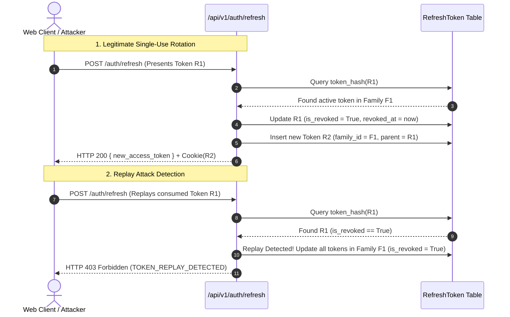

# WILDSCOPE AI — Security Phase 2: Authentication Services & Endpoints Report

**Module:** WILDSCOPE AI Backend API (`src/backend`)  
**Accountable Backend Architect:** Santosh Yuvaraj  
**Repository:** `HFT26-TEAM-8`  
**Git Branch:** `santosh`  
**Architecture Specification:** [`docs/backend/security-architecture-audit.md`](file:///c:/Users/santosh/OneDrive/Desktop/HFT26-TEAM-8/docs/backend/security-architecture-audit.md)  
**API Contract:** [`docs/api-contract.md`](file:///c:/Users/santosh/OneDrive/Desktop/HFT26-TEAM-8/docs/api-contract.md)  
**Date:** October 31, 2026  
**Status:** **PHASE 2 IMPLEMENTATION COMPLETE & VERIFIED**

---

## Executive Summary

Security Phase 2 delivers the operational authentication layer for WILDSCOPE AI, fulfilling the requirements established in the finalized Security Architecture Specification ([`docs/backend/security-architecture-audit.md`](file:///c:/Users/santosh/OneDrive/Desktop/HFT26-TEAM-8/docs/backend/security-architecture-audit.md)). Built directly upon the database models and Alembic migration `005` established in Phase 1, Phase 2 implements:

1. **Password Security:** Argon2id password hashing and constant-time verification with PBKDF2 standard library fallback, strict entropy validation, and anti-enumeration error responses.
2. **JWT Access Token Engine:** Standards-compliant HS256 tokens carrying cryptographic claims (`sub`, `role`, `username`, `email`, `jti`, `iat`, `exp`), bounded to a 15-minute expiration window.
3. **Authentication API Endpoints:** Complete implementations of `POST /api/v1/auth/login`, `POST /api/v1/auth/refresh`, `POST /api/v1/auth/logout`, and `GET /api/v1/auth/me` following the standard API response/error envelopes.
4. **Refresh Token Lifecycle & Replay Detection:** Single-use Refresh Token Rotation (RTR), SHA-256 hashed storage, token family grouping, automatic family-wide invalidation upon replay detection, and `HttpOnly`/`SameSite` cookie delivery with CSRF mitigation.
5. **Account & Role Security:** Real-time account status checks (`is_active`) and dynamic role evaluation in FastAPI dependencies, instantly revoking disabled or demoted sessions.
6. **Administrator Provisioning CLI:** A secure bootstrap utility (`python -m src.backend.cli create-admin`) with zero predictable default passwords, complexity enforcement, and duplicate overwrite prevention.

---

## 1. Architectural Components Implemented

### 1. Password Hashing & Verification ([`src/backend/core/security.py`](file:///c:/Users/santosh/OneDrive/Desktop/HFT26-TEAM-8/src/backend/core/security.py))
- **Primary Algorithm:** Argon2id via `argon2-cffi` ($t=2, m=64 \text{ MB}, p=4, \text{hash\_len}=32$).
- **Standard Library Fallback:** PBKDF2-HMAC-SHA256 with 600,000 iterations and 16-byte random salt, guaranteeing that environments without compiled C-extensions remain fully operational.
- **Timing Attack Mitigation:** Constant-time hash verification via `hmac.compare_digest`. Failed logins for non-existent users execute dummy password verification to maintain uniform execution timing and eliminate user enumeration.
- **Complexity Enforcement (`validate_password_complexity`):** Requires $\ge 10$ characters, $\ge 1$ uppercase, $\ge 1$ lowercase, $\ge 1$ digit, and $\ge 1$ special character (`!@#$%^&*()_+-=[]{}|;:,.<>?/`).

---

### 2. JWT Access Token Engine ([`src/backend/core/security.py`](file:///c:/Users/santosh/OneDrive/Desktop/HFT26-TEAM-8/src/backend/core/security.py))
- **Signing Algorithm:** HMAC-SHA256 (`HS256`) using `settings.JWT_SECRET_KEY`.
- **Claims Architecture:**
  - `sub`: User ID (UUID).
  - `role`: User RBAC persona (`admin`, `researcher`, `viewer`).
  - `username`: User handle.
  - `email`: User email address.
  - `jti`: Unique token ID (UUID hex) for tracking and revocation.
  - `iat`: UTC issuance timestamp.
  - `exp`: UTC expiration timestamp (default: 15 minutes).
- **Decoding & Verification:** Validates signature integrity, clock drift tolerance (10 seconds), and structure. Raises standardized `AuthenticationException` with error codes `TOKEN_EXPIRED` or `INVALID_TOKEN`.

---

### 3. Refresh Token Lifecycle & Replay Invalidation ([`src/backend/services/auth.py`](file:///c:/Users/santosh/OneDrive/Desktop/HFT26-TEAM-8/src/backend/services/auth.py))

- **Hashed Storage:** Raw 256-bit URL-safe tokens (`secrets.token_urlsafe(32)`) are hashed via SHA-256 before database insertion. Raw tokens are never persisted.
- **Family Rotation Lineage:** Every token carries `family_id` and optional `parent_token_hash`.
- **Replay Neutralization:** If an already-revoked token is presented, the system immediately revokes **all** active tokens sharing that `family_id`, blocking token theft attempts.

---

### 4. Cookie Security & CSRF Mitigation ([`src/backend/api/v1/auth.py`](file:///c:/Users/santosh/OneDrive/Desktop/HFT26-TEAM-8/src/backend/api/v1/auth.py))
- **Cookie Flags:**
  - `HttpOnly`: Accessible only to the HTTP protocol; JavaScript cannot access it, preventing XSS extraction.
  - `SameSite=lax`: Mitigates Cross-Site Request Forgery across standard navigations.
  - `Path=/api/v1/auth`: Restricts cookie transmission strictly to authentication routes.
  - `Secure`: Controlled by `settings.COOKIE_SECURE` (`False` in development localhost; `True` in production HTTPS).
- **CSRF Defense:** Cookie-based requests to `/auth/refresh` and `/auth/logout` require an anti-CSRF custom header (`X-Requested-With: XMLHttpRequest` or `X-CSRF-Token`) or verified Origin header matching `settings.CORS_ORIGINS`. Requests with explicit JSON body tokens are permitted without headers (as pre-flighted CORS already protects them).

---

### 5. Account & Role Validation ([`src/backend/core/auth_deps.py`](file:///c:/Users/santosh/OneDrive/Desktop/HFT26-TEAM-8/src/backend/core/auth_deps.py))
- **`get_current_user`**: Validates JWT Bearer token and resolves live `User` entity from the database.
- **`get_current_active_user`**: Enforces `user.is_active == True`. Deactivated accounts immediately return HTTP 403 `ACCOUNT_DISABLED`.
- **Dynamic Role Resolution**: Because user roles are queried live, any administrative role demotion takes effect on the very next API request, preventing stale token claims from granting revoked privileges.

---

### 6. Administrator Provisioning CLI ([`src/backend/cli.py`](file:///c:/Users/santosh/OneDrive/Desktop/HFT26-TEAM-8/src/backend/cli.py))
- **Usage:**
  ```powershell
  python -m src.backend.cli create-admin --username admin --email admin@wildscope.org --password <StrongPassword123!>
  ```
- **Safety Controls:**
  - Prompts securely via `getpass` if `--password` is omitted.
  - Validates password complexity before executing database mutations.
  - Refuses to overwrite existing accounts unless `--force` is explicitly provided.
  - Never logs or prints plaintext passwords or credential hashes.

---

## 2. API Endpoints Specification

| Method | Endpoint URL | Status | Payload | Response Data | Notes |
|:---|:---|:---:|:---|:---|:---|
| `POST` | `/api/v1/auth/login` | **200 OK** | `{"username_or_email": "...", "password": "..."}` | `access_token`, `token_type`, `expires_in_seconds`, `user` profile | Sets `HttpOnly` refresh token cookie. |
| `POST` | `/api/v1/auth/refresh` | **200 OK** | Cookie or optional `{"refresh_token": "..."}` | New `access_token`, `token_type`, `expires_in_seconds`, `user` | Rotates token; invalidates family on replay. |
| `POST` | `/api/v1/auth/logout` | **200 OK** | Cookie or optional `{"refresh_token": "..."}` | `{"message": "Successfully logged out. Session revoked."}` | Revokes refresh token; clears cookie. |
| `GET` | `/api/v1/auth/me` | **200 OK** | Header: `Authorization: Bearer <token>` | `id`, `username`, `email`, `role`, `full_name`, `is_active`, `created_at` | Resolves live user from DB. |

---

## 3. Regression Test Suite Details

A comprehensive regression test suite was implemented in [`tests/backend/test_auth_endpoints.py`](file:///c:/Users/santosh/OneDrive/Desktop/HFT26-TEAM-8/tests/backend/test_auth_endpoints.py) containing 17 automated tests:

| Test Function | Category | Scenario Verified |
|:---|:---|:---|
| `test_login_success_with_username_and_email` | Login | Verifies login succeeds using either username or email, returns access token, and sets `HttpOnly` cookie. |
| `test_login_failure_incorrect_password` | Login | Verifies wrong password returns uniform 401 `INVALID_CREDENTIALS`. |
| `test_login_failure_nonexistent_user` | Login | Verifies non-existent user returns identical 401 error, preventing user enumeration. |
| `test_login_disabled_account_forbidden` | Login | Verifies deactivated user cannot log in and receives 403 `ACCOUNT_DISABLED`. |
| `test_get_me_success` | Tokens | Verifies valid Bearer token returns profile data on `GET /auth/me`. |
| `test_get_me_missing_token_unauthorized` | Tokens | Verifies missing Authorization header returns 401 `AUTHENTICATION_REQUIRED`. |
| `test_get_me_expired_token` | Tokens | Verifies expired access token is rejected with 401 `TOKEN_EXPIRED`. |
| `test_get_me_tampered_signature` | Tokens | Verifies tampered JWT signature is rejected with 401 `INVALID_TOKEN`. |
| `test_deactivated_user_bearer_token_blocked` | Tokens | Verifies active token is immediately rejected if account is disabled in database (403 `ACCOUNT_DISABLED`). |
| `test_refresh_token_rotation_success` | Rotation | Verifies single-use rotation issues new access token, updates cookie, and marks old token revoked. |
| `test_refresh_token_replay_attack_revokes_family` | Replay | Verifies replaying a consumed refresh token triggers family invalidation and returns 403 `TOKEN_REPLAY_DETECTED`. |
| `test_logout_revokes_token_and_clears_cookie` | Logout | Verifies `/auth/logout` marks refresh token revoked in DB and clears `HttpOnly` cookie. |
| `test_csrf_protection_rejects_cookie_refresh_without_header` | CSRF | Verifies cookie-based refresh without custom header returns 403 `CSRF_VALIDATION_FAILED`. |
| `test_csrf_protection_permits_json_body_token` | CSRF | Verifies explicit JSON body token refresh succeeds without CSRF header. |
| `test_admin_bootstrap_cli_creation` | CLI | Verifies `create_admin_user` provisions administrator with role `admin` and active status. |
| `test_admin_bootstrap_rejects_weak_password` | CLI | Verifies bootstrap enforces password complexity rules. |
| `test_admin_bootstrap_prevents_unintentional_overwrite` | CLI | Verifies bootstrap refuses to overwrite existing accounts without `--force`. |

---

## 4. Local Execution & Verification Instructions

Execute the test suites in your local Windows terminal:

```powershell
# 1. Activate virtual environment
.\.venv\Scripts\Activate.ps1

# 2. Run Security Phase 2 Authentication test suite
python -m pytest tests/backend/test_auth_endpoints.py -v

# 3. Run Security Phase 1 Database test suite
python -m pytest tests/backend/test_auth_database.py -v

# 4. Run full backend test suite (Auth Endpoints + Auth DB + Cycles A & B + Schemas)
python -m pytest tests/backend/test_auth_endpoints.py tests/backend/test_auth_database.py tests/backend/test_remediation_cycle_b.py tests/backend/test_remediation_cycle_a.py tests/backend/test_schemas.py -v
```

---

## 5. Strict Boundaries & Compliance Statement

- **Existing Business Routes Untouched:** No modifications were made to existing routes (`/reviews`, `/uploads`, `/cameras`, etc.). These remain completely open as requested until Security Phase 3 attaches route guards.
- **Frontend Isolation:** No files in `src/frontend/` were modified.
- **Teammate Isolation:** Zero modifications were made to `src/frontend/` (Aarav), `src/inference/` (Harsh), `src/intelligence/` (Diya), or `wildscope_analytics/`.
- **Branch Preservation:** Maintained strictly on `santosh`. No git commits, pushes, merges, stashes, or resets were executed.
- **Scientific Immutability:** Append-only review history and raw prediction immutability are fully preserved.
