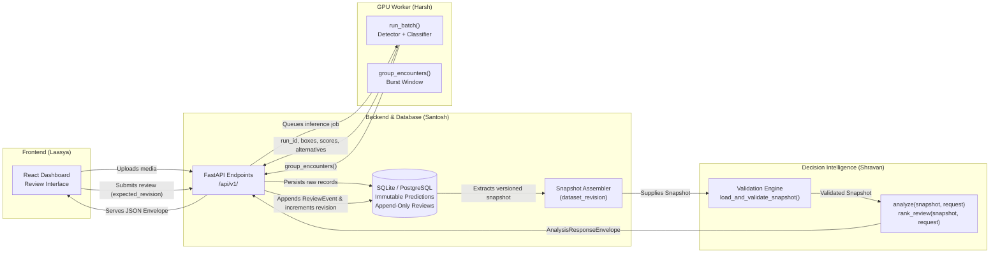

# WILDSCOPE Phase 1: Team Handoff & Integration Guide

> **Prepared by:** Shravan (Analytics & Decision Intelligence Lead)  
> **Audience:** Harsh (Vision/ML), Santosh (Backend/DB), Laasya (Frontend/UI)  
> **Status:** Proposed v1 Architecture & Contract Specification  
> **Notice:** *The contracts specified herein are proposed by Shravan for Phase 1. They reflect the live-inference solution guide requirements and await formal team alignment.*

---

## 1. System Integration Flow & Ownership

---

## 2. Role-by-Role Integration Instructions

### 2.1 For Harsh (Vision & Model Inference)

Harsh produces raw detections and groups related frames into encounters.

#### What to supply in `run_batch()` output:
1. **Separate Detection from Classification Confidence:**
   - `animal_detection_confidence`: objectness score (e.g. from MegaDetector) `[0.0, 1.0]`.
   - `classification_confidence`: species classifier score `[0.0, 1.0]`.
   - `score_type`: declare whether scores are `"raw"`, `"softmax"`, or `"calibrated"`.
2. **Explicit Triage States (`TriageState`):**
   - `"animal_detected"`: animal present.
   - `"likely_empty"`: background / vegetation motion (do not supply a species).
   - `"unsupported_taxon"`: animal present but outside classifier catalog.
   - `"processing_failure"`: decode error or corrupted frame.
3. **Alternative Species Hypotheses (`alternatives`):**
   - Include top-k candidate species with scores (e.g. `[{"taxon_id": "panthera_pardus", "score": 0.08}]`).
   - Essential for Shravan's Phase 2 conclusion-sensitive review ranking.
4. **Normalized Bounding Boxes (`NormalizedBBox`):**
   - Convention: `[x_min, y_min, x_max, y_max]` in `[0.0, 1.0]`. Top-left is `(0, 0)`, bottom-right is `(1, 1)`.
5. **Encounter Grouping (`group_encounters()`):**
   - Group observations strictly within the same camera trap.
   - Do **not** mix observations from different cameras into one encounter.

---

### 2.2 For Santosh (Backend, Persistence, & Snapshot Assembly)

Santosh persists evidence and exports unified `Snapshot` objects.

#### Persistence Rules:
1. **Immutability of Machine Predictions:**
   - Raw model outputs in the `detections` table are **never updated or deleted**.
2. **Append-Only Review History:**
   - When a researcher reviews an encounter or detection in Laasya's UI, insert a new `ReviewEvent` record into `reviews`.
   - Include `expected_revision` submitted by the frontend. If `expected_revision != current_revision`, abort and return **HTTP 409 Conflict** to prevent stale overwrites.
   - Successful reviews increment `dataset_revision` transactionally (`revision = revision + 1`).
3. **Assembling the Snapshot:**
   - Collect all cameras, media, observations, detections, encounters, reviews, monitoring efforts, and spatial context into the standard `Snapshot` model.
   - Set `metadata.dataset_revision` to the current database counter.
   - Set `metadata.schema_version` to `"1.0.0"`.
   - Pass the snapshot to `load_and_validate_snapshot()` before calling analytical functions.

---

### 2.3 For Laasya (Frontend & UI)

Laasya renders charts, maps, review queues, and explanations.

#### What to Expect in API Responses:
1. **Unified Envelope (`AnalysisResponseEnvelope`):**
   - Every analytical request returns a standardized structure with `status`, `schema_version`, `dataset_revision`, `result`, `evidence_references`, `warnings`, and `limitations`.
2. **Five Distinct Status Values:**
   - `"ok"`: Metric successfully computed.
   - `"partial"`: Valid calculation, but some records were excluded (e.g. photos without timestamps). Check `excluded_records_count` and `exclusion_reasons`.
   - `"insufficient_data"`: Entity exists but quantity is inadequate (e.g. zero monitoring hours recorded).
   - `"unavailable"`: Requested feature cannot run (e.g. no GPS coordinates exist for a camera trap).
   - `"invalid_request"`: Client error or stale revision conflict. Check `errors` for structured field paths and codes.
3. **No Fabricated Zeroes:**
   - If monitoring effort is missing, effort-normalized rates return `status="unavailable"`, **not** `0.0`.
4. **Evidence Transparency:**
   - Clickable citations: Inspect `evidence_references` containing observation and detection IDs to display thumbnail modals.

---

## 3. Decisions Requiring Formal Team Agreement

The following design decisions are proposed in Phase 1 and require formal review during our next sync:

1. **Taxon Naming Convention:**
   - *Proposal:* Standardize all species IDs to lower snake_case scientific binomials (e.g. `"panthera_tigris"`, `"axis_axis"`, `"canis_aureus"`).
   - *Alternative:* Common English names (`"tiger"`, `"chital"`). English names can be kept in `raw_label` for display.
2. **Encounter Grouping Window:**
   - *Proposal:* Default temporal gap threshold of 30 minutes on the same camera trap (`"v1_time_gap_30min"`).
   - *Team Input Needed:* Harsh & Shravan to confirm if burst threshold should be 15 or 30 minutes.
3. **Monitoring Effort Normalization:**
   - *Proposal:* Active monitoring intervals must be pre-merged, sorted, and strictly non-overlapping before snapshot creation.
   - *Team Input Needed:* Santosh to confirm whether the backend handles interval merging during telemetry ingestion.
4. **Optimistic Concurrency Strategy:**
   - *Proposal:* Atomic integer revision counter (`dataset_revision`). All mutation endpoints require `expected_revision` and return 409 Conflict if outdated.
   - *Team Input Needed:* Santosh to confirm table locking / transactional mechanics in PostgreSQL/SQLite.
